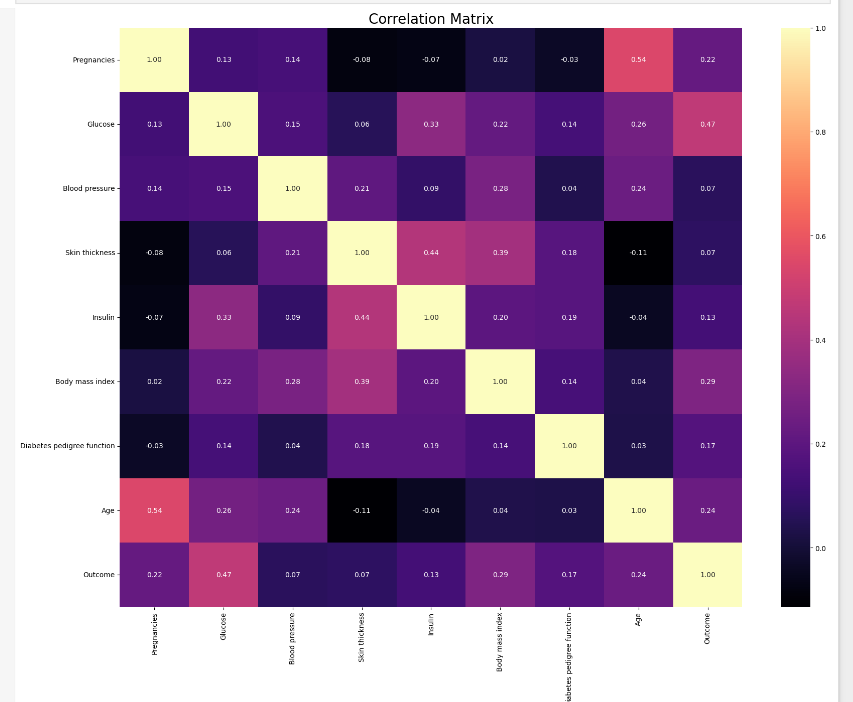

# Diabetes Prediction: EDA and KNN Classifier

Exploratory data analysis and a machine-learning model that predicts whether a patient has diabetes, using the **Pima Indians Diabetes Dataset**. The project also includes a **Power BI dashboard** built from the same data.

---

## Results

A **K-Nearest Neighbors** classifier (k = 11, Euclidean distance) trained on 80% of the data and tested on the remaining 20%:

| Metric | Score |
|---|---|
| Accuracy | **74.7%** |
| F1 score | **0.64** |

Confusion matrix (test set, 154 patients):

| | Predicted: no diabetes | Predicted: diabetes |
|---|---|---|
| **Actual: no diabetes** | 80 | 19 |
| **Actual: diabetes** | 20 | 35 |

---

## Dataset

- 768 patients (female, Pima Indian heritage, aged 21+) and 9 columns
- Features: Pregnancies, Glucose, Blood pressure, Skin thickness, Insulin, Body mass index, Diabetes pedigree function, Age
- Target: `Outcome` (1 = diabetic, 0 = not diabetic). 268 patients are diabetic and 500 are not.

---

## What the notebook does

`Diabetes_dataset.ipynb` has three parts:

1. **Exploratory data analysis:** dataset shape, class balance, summary statistics, a correlation heatmap, and distributions of each feature
2. **Data preprocessing:** zeros in Glucose, Blood pressure, Skin thickness, Insulin and BMI are physically impossible, so they are treated as missing values and replaced with the column mean
3. **Model building:** a train/test split (80/20, `random_state=42`), feature scaling with `StandardScaler`, a KNN classifier, and evaluation with accuracy, F1 score and a confusion matrix

### Correlation heatmap



### Feature distributions


### Power BI dashboard (`Dashboard.pbix`)


---

## Tech stack

Python · pandas · NumPy · scikit-learn · Matplotlib · seaborn · Jupyter · Power BI

---

## How to run

1. Download the Pima Indians Diabetes Dataset (it is freely available on Kaggle and from the UCI repository).
2. Save it as `data/pima_diabetes.xlsx`. The notebook expects these column names: `Pregnancies, Glucose, Blood pressure, Skin thickness, Insulin, Body mass index, Diabetes pedigree function, Age, Outcome`. Rename them if your copy uses different names, such as `BloodPressure`.
3. Install the dependencies and open the notebook:

```bash
pip install -r requirements.txt
jupyter notebook Diabetes_dataset.ipynb
```

To open the dashboard, use Power BI Desktop (Windows).

---

## Possible improvements

- Compare KNN with other models, such as logistic regression and random forest
- Tune `k` with cross-validation
- Improve recall for the diabetic class, which is the more important error to avoid in a medical setting
